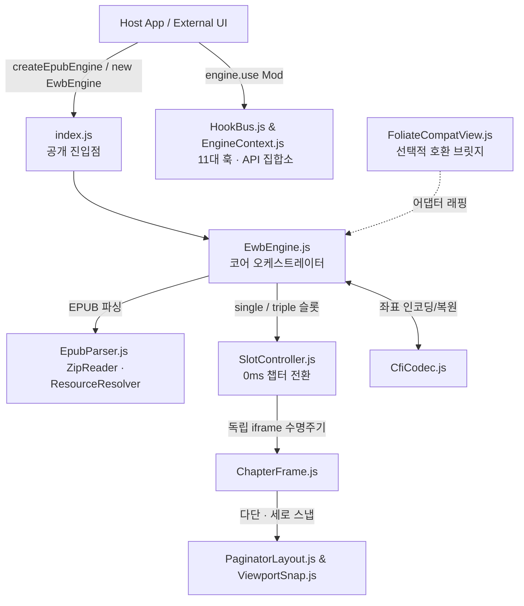

# 📄 EWB-JS (Modern HTML5 EPUB Web Engine) - 기술 사양 및 파일 안내서
> **기준 경로**: `ewp-js` | **구조**: Modular Core + Plugin(Mod) Specs

> **[🤖 AI Context Instructions]**
> - **Architecture**: `Host App` -> `index.js` -> `EwbEngine.js` -> `SlotController.js` / `ChapterFrame.js` -> `PaginatorLayout.js` / `ViewportSnap.js` / `CfiCodec.js`
> - **Core Immutability**: 코어(`core/`, `layout/`, `parser/`, `bridge/`, `utils/`, `index.js`)를 직접 개조하지 않고 `engine.use(mod)` + `HookBus` + `EngineContext.registerApi()`로 기능을 확장합니다.
> - **Style Priority**: `#ewb-core-layout-style` -> `#ewb-user-style` -> `#ewb-theme-style` 순서를 유지합니다.

---
## 🛠 1. EWB-JS 아키텍처 흐름

---
## 📁 2. 파일 카탈로그 요약

### 🖥️ EntryPoint (공개 진입점)
| 파일명 | 파일 경로 | 라인 | 용량 | 역할 요약 |
| :--- | :--- | :---: | :---: | :--- |
| **`index.js`** | `ewb-js/index.js` | 55 | 2.0 KB | 📚 EWB-JS (Modern HTML5 EPUB Web Engine) 공식 공개 진입점 |

### 🖥️ Core Engine (코어 오케스트레이터 · 슬롯 · 훅)
| 파일명 | 파일 경로 | 라인 | 용량 | 역할 요약 |
| :--- | :--- | :---: | :---: | :--- |
| **`ChapterFrame.js`** | `ewb-js/core/ChapterFrame.js` | 1037 | 41.2 KB | 🖼️ 단일 챕터 독립 iframe 생명주기 및 사전 조판 완결 단위 (ChapterFrame) |
| **`EngineContext.js`** | `ewb-js/core/EngineContext.js` | 364 | 15.3 KB | 🏛️ EWB 게임 모드(Mod/Plugin)용 공식 API 집합소 (EngineContext) |
| **`EwbEngine.js`** | `ewb-js/core/EwbEngine.js` | 1212 | 51.8 KB | 🚀 EWB 차세대 확장형 EPUB 뷰어 코어 엔진 오케스트레이터 (EwbEngine) |
| **`HookBus.js`** | `ewb-js/core/HookBus.js` | 202 | 7.4 KB | 🔌 EWB 엔진 라이프사이클 중계소 & 미들웨어 훅 버스 (HookBus) |
| **`SlotController.js`** | `ewb-js/core/SlotController.js` | 547 | 22.5 KB | 🪟 단일(single) / 트리플(triple) 슬롯 선택 내장 및 0ms 챕터 전환 컨트롤러 (SlotController) |

### 🖥️ Layout & CFI (조판 · 라인 스냅 · CFI 코덱)
| 파일명 | 파일 경로 | 라인 | 용량 | 역할 요약 |
| :--- | :--- | :---: | :---: | :--- |
| **`CfiCodec.js`** | `ewb-js/layout/CfiCodec.js` | 406 | 15.7 KB | 🧭 국제 표준 EPUB CFI 인코더/디코더 및 DOM Range 좌표 변환기 (CfiCodec) |
| **`PaginatorLayout.js`** | `ewb-js/layout/PaginatorLayout.js` | 942 | 43.1 KB | 📐 HTML5 표준 다단(CSS Multi-column) & 세로 페이지 스냅 조판 레이아웃 엔진 (PaginatorLayout) |
| **`ViewportSnap.js`** | `ewb-js/layout/ViewportSnap.js` | 421 | 17.1 KB | 📐 뷰포트 짝수 조판 계산 및 DOM Range 기반 텍스트 라인 스냅 엔진 (ViewportSnap) |

### 🖥️ Parser & Resources (ZIP · EPUB 파서 · 리소스)
| 파일명 | 파일 경로 | 라인 | 용량 | 역할 요약 |
| :--- | :--- | :---: | :---: | :--- |
| **`EpubParser.js`** | `ewb-js/parser/EpubParser.js` | 641 | 24.4 KB | 📖 EWB 엔진 표준 EPUB 2.0 / 3.0 패키지 파서 (EpubParser) |
| **`ResourceResolver.js`** | `ewb-js/parser/ResourceResolver.js` | 298 | 12.5 KB | 🔗 EWB 엔진 리소스 경로 해석 및 Blob URL 수명주기 관리자 (ResourceResolver) |
| **`ZipReader.js`** | `ewb-js/parser/ZipReader.js` | 290 | 9.6 KB | 📦 EWB 엔진 전용 ZIP 아카이브 리더 어댑터 (ZipReader) |

### 🖥️ Bridge Adapters (호환 브릿지)
| 파일명 | 파일 경로 | 라인 | 용량 | 역할 요약 |
| :--- | :--- | :---: | :---: | :--- |
| **`FoliateCompatView.js`** | `ewb-js/bridge/FoliateCompatView.js` | 388 | 14.3 KB | 🔌 Foliate-View 호환 브릿지 Web Component 어댑터 (FoliateCompatView) |

### 🖥️ Utilities & Logging (로거 · 유틸리티)
| 파일명 | 파일 경로 | 라인 | 용량 | 역할 요약 |
| :--- | :--- | :---: | :---: | :--- |
| **`LayoutTraceReporter.js`** | `ewb-js/utils/LayoutTraceReporter.js` | 302 | 17.0 KB | 🔬 EWB-JS 순수 뷰어 조판 스냅샷 & 그룹 추적 리포터 (LayoutTraceReporter) |
| **`Logger.js`** | `ewb-js/utils/Logger.js` | 212 | 8.4 KB | 🛠️ EWB 엔진 전용 주입형 4대 컨텍스트 추적 로거 (Logger) |

### 🖥️ Docs & Config (문서 및 설정)
| 파일명 | 파일 경로 | 라인 | 용량 | 역할 요약 |
| :--- | :--- | :---: | :---: | :--- |
| **`API.md`** | `API.md` | 506 | 42.7 KB | EWB-JS API & Mod Development Guide |
| **`package.json`** | `package.json` | 47 | 1.1 KB | 패키지 및 프로젝트 설정 |
| **`readme.md`** | `readme.md` | 328 | 17.3 KB | EWB-JS (Modern HTML5 EPUB Web Engine) |

---
## 🧩 3. 핵심 모듈 공개 인터페이스 (Public APIs)

> *EWB-JS 모듈별 의존성 및 Export 인터페이스 명세입니다.*

#### 📄 `ewb-js/bridge/FoliateCompatView.js`
- **참조 (Dependencies)**: `EwbEngine.js`
- **핵심 API (Exports)**: `class FoliateCompatView`, `registerCompatElement()`

#### 📄 `ewb-js/core/ChapterFrame.js`
- **참조 (Dependencies)**: `PaginatorLayout.js`
- **핵심 API (Exports)**: `class ChapterFrame`, `FrameState`

#### 📄 `ewb-js/core/EngineContext.js`
- **참조 (Dependencies)**: `ChapterFrame.js`
- **핵심 API (Exports)**: `class EngineContext`

#### 📄 `ewb-js/core/EwbEngine.js`
- **참조 (Dependencies)**: `CfiCodec.js`, `EngineContext.js`, `EpubParser.js`, `HookBus.js`, `Logger.js`, `SlotController.js`
- **핵심 API (Exports)**: `class EwbEngine`, `EngineState`

#### 📄 `ewb-js/core/HookBus.js`
- **핵심 API (Exports)**: `class HookBus`

#### 📄 `ewb-js/core/SlotController.js`
- **참조 (Dependencies)**: `ChapterFrame.js`
- **핵심 API (Exports)**: `class SlotController`

#### 📄 `ewb-js/index.js`
- **참조 (Dependencies)**: `EwbEngine.js`
- **핵심 API (Exports)**: `createEpubEngine()`

#### 📄 `ewb-js/layout/CfiCodec.js`
- **핵심 API (Exports)**: `class CfiCodec`, `compareCfiStart()`, `isSameCfiStart()`

#### 📄 `ewb-js/layout/PaginatorLayout.js`
- **핵심 API (Exports)**: `class PaginatorLayout`

#### 📄 `ewb-js/layout/ViewportSnap.js`
- **핵심 API (Exports)**: `calculateExactLineHeight()`, `calculateLayoutMetrics()`, `collectVisibleTextLines()`, `getFirstVisibleLine()`, `getLastVisibleLine()`, `calculateScrolledLineSnapDelta()`

#### 📄 `ewb-js/parser/EpubParser.js`
- **참조 (Dependencies)**: `ResourceResolver.js`, `ZipReader.js`
- **핵심 API (Exports)**: `class EpubParser`

#### 📄 `ewb-js/parser/ResourceResolver.js`
- **참조 (Dependencies)**: `ZipReader.js`
- **핵심 API (Exports)**: `class ResourceResolver`

#### 📄 `ewb-js/parser/ZipReader.js`
- **참조 (Dependencies)**: `fflate`
- **핵심 API (Exports)**: `class ZipReader`, `normalizeZipPath()`, `resolveRelativeZipPath()`, `guessMimeType()`

#### 📄 `ewb-js/utils/LayoutTraceReporter.js`
- **핵심 API (Exports)**: `isLoggerDebugEnabled()`, `createBufferedLayoutLogger()`, `captureLayoutSnapshot()`, `emitPureLayoutReport()`

#### 📄 `ewb-js/utils/Logger.js`
- **핵심 API (Exports)**: `class EngineLogger`, `createLogger()`
